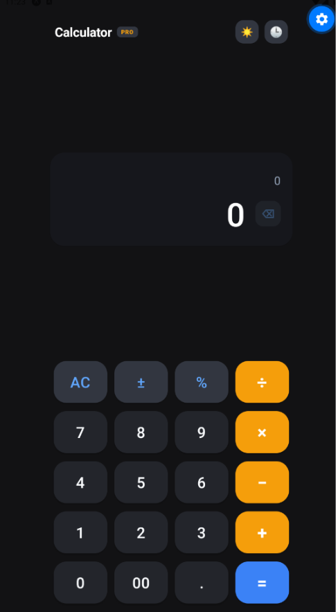
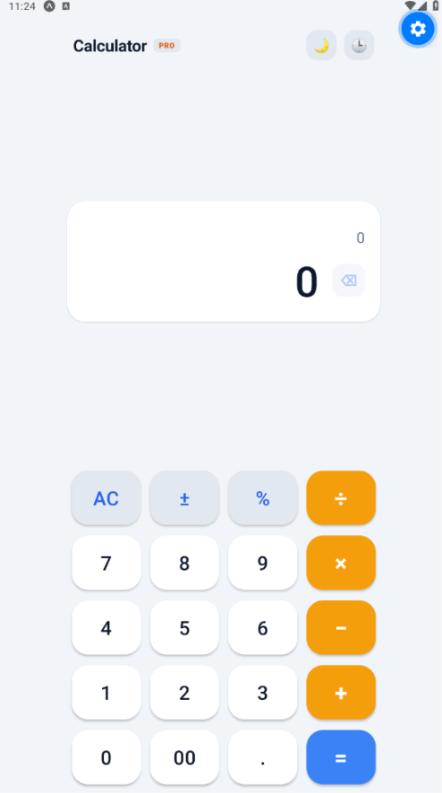
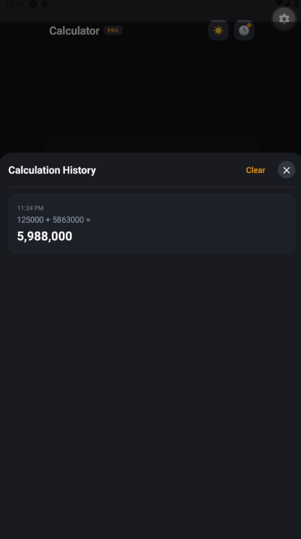

<div align="center">

# 📱 Modern Simple Calculator App

### **ITS2127: Application & Mobile Development (AMD)**
*Conducted at the Institute of Software Engineering (IJSE) — Semester 03*

<br/>

[](https://reactnative.dev/)
[](https://expo.dev/)
[](https://www.typescriptlang.org/)
[](https://www.nativewind.dev/)
[](https://docs.expo.dev/router/introduction/)

[](https://www.ijse.lk/)
[](LICENSE)

<br/>
<br/>

**A sleek, responsive, and tactile mobile calculator built with React Native and Expo.**  
Features dynamic light/dark theming, real-time formula preview, calculation history tape, and precision math logic.

</div>

---

## 📸 App Screenshots

<div align="center">

| 🌙 Dark Theme | ☀️ Light Theme | 📜 Calculation History |
| :---: | :---: | :---: |
|  |  |  |

</div>

---

## ✨ Core Features

- **🎨 Dynamic Theming (Dark & Light Mode)**
  - Seamlessly switch between a deep charcoal dark theme and a clean slate light theme with one tap (`☀️` / `🌙`).
- **⚡ Real-Time Live Preview**
  - Instant calculation preview appears below your expression as you type, before pressing equals (`=`).
- **📜 Calculation History Tape**
  - Keeps track of past calculations with timestamps.
  - Slide-up history sheet allows reviewing, tapping any previous result to reload it onto the calculator, or clearing history.
- **🔢 Accurate Mathematical Engine (BODMAS / PEMDAS)**
  - Two-pass operator precedence evaluation (`×` and `÷` before `+` and `−`).
  - Floating-point precision correction (avoids `0.1 + 0.2 = 0.30000000000000004` IEEE-754 rounding bugs).
  - Division by zero safety protection (`Cannot divide by 0`).
- **🎯 Smart UX Enhancements**
  - **Inline Backspace (`⌫`)**: Single tap to delete character, long-press to clear.
  - **Sign Toggle (`±`)**: Easily switch between positive and negative numbers.
  - **Percentage (`%`)**: Quick percentage conversion.
  - **Formatted Display**: Comma grouping (`1,234,567`) with dynamic font auto-scaling and horizontal scrolling for large numbers.
- **📱 100% Cross-Platform**
  - Runs natively on **Android**, **iOS**, and **Web**.

---

## 🛠️ Tech Stack & Libraries

| Technology | Role | Version |
|---|---|---|
| **React Native** | Core Mobile Framework | `0.88.1` |
| **Expo** | Mobile App Platform & Tooling | `~58.0.21` |
| **Expo Router** | File-based Routing & Navigation | `~58.0.28` |
| **TypeScript** | Static Type Safety | `~6.0.3` |
| **NativeWind & Tailwind CSS** | Utility-First Styling | `^4.2.7` / `^3.4.19` |
| **Safe Area Context** | Notch & Screen Insets Handling | `~5.10.1` |
| **Expo Status Bar** | Dynamic Status Bar Theming | `~58.0.4` |

---

## 📁 Project Structure

```text
calculator-app/
├── assets/
│   └── calculator-img/             # Application screenshots for documentation
│       ├── calc-app-dark.png       # Dark mode screenshot
│       ├── calc-app-light.png      # Light mode screenshot
│       └── calc-app-history.png    # History drawer screenshot
├── src/
│   ├── app/
│   │   ├── _layout.tsx             # Root Stack layout with dynamic StatusBar
│   │   └── index.tsx               # Main calculator screen with keypad & theme toggle
│   ├── components/
│   │   ├── CalculatorButton.tsx    # Tactile animated button with press states
│   │   ├── CalculatorDisplay.tsx   # Dual-line expression & result display with inline backspace
│   │   └── HistoryModal.tsx        # Calculation history slide-up modal with recall
│   ├── constants/
│   │   └── theme.ts                # Color palettes for Dark and Light modes
│   ├── hooks/
│   │   ├── use-color-scheme.ts     # Platform color scheme hook
│   │   └── use-theme.ts            # Theme accessor hook
│   ├── types/
│   │   └── calculator.ts           # Type definitions for history, buttons, and themes
│   └── utils/
│       └── calculatorLogic.ts      # Pure math evaluation engine, BODMAS & formatting
├── app.json                        # Expo app configuration
├── package.json                    # Dependencies and scripts
└── tsconfig.json                   # TypeScript configuration
```

---

## 🚀 Getting Started

### Prerequisites

- [Node.js](https://nodejs.org/) (v18 or higher)
- [Git](https://git-scm.com/)
- [Expo Go](https://expo.dev/go) app installed on your physical device (Android / iOS)

### Installation & Setup

1. **Clone the repository:**
   ```bash
   git clone https://github.com/chathunga2007/ITS2127-Simple-Calculator-Mobile-App.git
   cd ITS2127-Simple-Calculator-Mobile-App/calculator-app
   ```

2. **Install dependencies:**
   ```bash
   npm install
   ```

3. **Start the development server:**
   ```bash
   npx expo start
   ```

### Device Testing

- **Android Device / Emulator**: Press `a` in the terminal or scan the terminal QR code with **Expo Go**.
- **iOS Simulator**: Press `i` in the terminal.
- **Web Browser**: Press `w` in the terminal to run in your local web browser.

---

## 🧪 Code Quality & Verification

Verify TypeScript compilation and lint rules:

```bash
# TypeScript compiler check
npx tsc --noEmit

# Expo ESLint check
npx expo lint
```

---

## 👨‍💻 Author

- **Chathunga Bimsara**
- GitHub: [@chathunga2007](https://github.com/chathunga2007)
- Institute: **IJSE - Institute of Software Engineering**
- Course: **Application & Mobile Development (AMD)** — Semester 03

---

## 📄 License

This project is licensed under the [MIT License](LICENSE).
